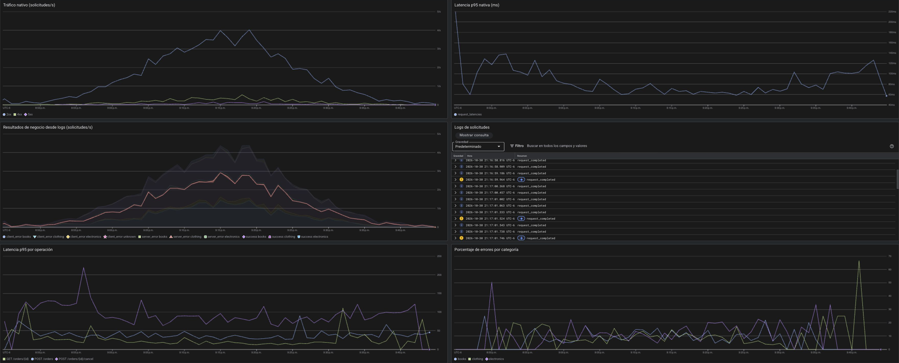

# API serverless observable en Google Cloud

Laboratorio de una API de pedidos en Cloud Run functions, desplegada con Terraform y observada con Cloud Monitoring y logs estructurados.

La corrida completó **6000 solicitudes en 3600.005 segundos**, con 5381 respuestas exitosas, 497 errores de cliente, 122 errores del servidor y cero errores de conexión. Los errores fueron parte del experimento. En `electronics`, la tasa de errores 4xx aumentó de **8.82 % a 15.10 %** durante el escenario configurado.

## Reporte y dashboard

- [Reporte PDF en primera persona](entrega/reporte_laboratorio_gcp.pdf)
- [Reporte editable](entrega/reporte_editable.md)
- [Dashboard HTML interactivo](entrega/dashboard.html): descarga el archivo y ábrelo con un navegador; funciona sin conexión.
- [CSV anonimizado](data/requests.csv)
- [Resultados calculados](entrega/resultados.json)
- [Privacidad de la publicación](PRIVACIDAD.md)



Las capturas oscuras son evidencias de GCP. Los gráficos interactivos del HTML y las figuras claras se calcularon desde el CSV. La latencia del cliente incluye la red; la latencia registrada por la aplicación y la métrica nativa de Cloud Run son mediciones diferentes.

## Contenido

```text
lab/
  backend/          API HTTP con entrada handle
  infra/            Terraform y configuración de ejemplo
  simulator/        Carga asíncrona con agenda normal truncada
  observability/    Consultas SQL parametrizadas
  tests/            Pruebas de API y simulador
data/               Mediciones anonimizadas de la corrida
entrega/            Reporte, dashboard y capturas de paneles
tools/              Generación de entregables y auditoría de publicación
```

## Ejecutar en un proyecto propio

Se requiere un proyecto con facturación habilitada, permisos para desplegar infraestructura y una cuenta de Google Cloud autenticada. Los recursos consumen crédito o generan cargos según la cuenta utilizada.

### Desplegar desde Cloud Shell

```bash
git clone https://github.com/Andyfer004/LAB-GCP.git
cd LAB-GCP
export PROJECT_ID="YOUR_PROJECT_ID"
gcloud config set project "$PROJECT_ID"
gcloud services enable cloudresourcemanager.googleapis.com serviceusage.googleapis.com --project="$PROJECT_ID"
cp lab/infra/terraform.tfvars.example lab/infra/terraform.tfvars
```

Reemplaza `YOUR_PROJECT_ID` en tu copia local de `terraform.tfvars`. Ese archivo se excluye de Git.

```bash
cd lab/infra
terraform init
terraform validate
terraform plan -out=lab.tfplan
terraform apply lab.tfplan
```

Si Terraform solicita credenciales ADC, ejecuta `gcloud auth application-default login` y configura el proyecto de cuota de tu cuenta. Conserva las credenciales en el almacén local de Google Cloud, fuera del repositorio.

La infraestructura incluye función pública para el simulador, Firestore, bucket de código, cuentas de servicio, una métrica basada en logs y un dashboard. La métrica se crea antes del tráfico. La activación de Analytics en el bucket de logs es permanente.

### Configurar el simulador

Desde `lab/`, en el entorno que tenga acceso al estado de Terraform:

```bash
python3 -m venv .venv
source .venv/bin/activate
python -m pip install -r simulator/requirements.txt
python configure_simulator.py
python simulator/simulator.py --dry-run
```

El configurador escribe la URL en **`simulator/config.local.json`**, excluido de Git. Si vas a ejecutar desde una laptop o VM distinta, copia `config.example.json` a `config.local.json` allí y configura la URL en esa copia privada.

### Generar una hora de tráfico

En una laptop o VM, desde `lab/` con las dependencias instaladas y la configuración local lista:

```bash
python simulator/simulator.py
```

En macOS puedes usar `caffeinate -i python simulator/simulator.py` para evitar suspensión por inactividad. Mantén la computadora abierta y conectada a internet.

El simulador agenda los envíos con media de 30 y desviación estándar de 10 minutos, truncando al intervalo de 0 a 60 por rechazo. Cada solicitud se lanza independientemente. El escenario duplica la probabilidad de errores intencionales de `electronics` entre los minutos 35 y 45; las fallas internas se configuran por separado.

Los resultados de cada nueva corrida permanecen fuera de Git. La publicación incluida en `data/` conserva las mediciones, pero reemplaza las referencias reales por referencias secuenciales anónimas y elimina las fechas absolutas del CSV.

### Completar el dashboard de GCP

El dashboard creado por Terraform contiene tráfico y p95 nativos, una métrica basada en logs y un panel de logs. Para añadir las dos gráficas SQL al mismo dashboard:

1. Abre Log Analytics o Estadísticas de observabilidad y selecciona la hora de tu corrida.
2. Copia una consulta de `lab/observability/`.
3. Reemplaza `YOUR_PROJECT_ID` y `YOUR_RUN_ID` localmente con los valores de tu corrida.
4. Ejecuta y configura `minute` como eje X, `error_pct` por categoría o `p95_latency_ms` por operación.
5. Guarda la gráfica en el dashboard existente y repite con la otra consulta.

Terraform administra el JSON completo del dashboard. Si añades gráficos desde la consola, incorpora los cambios al código antes de volver a aplicar Terraform para evitar reemplazar las adiciones manuales.

### Limpiar recursos

Después de guardar las evidencias, desde `lab/infra`:

```bash
terraform destroy
```

Esto borra también la base de pedidos del laboratorio. Las APIs y la activación de Analytics permanecen. Revisa los artefactos de builds que GCP haya creado automáticamente y elimina únicamente los que correspondan a tu laboratorio. No borres el estado de Terraform antes de completar la limpieza.

## Pruebas locales

```bash
python3 -m venv .venv
source .venv/bin/activate
python -m pip install -r lab/requirements-dev.txt
python -m pytest lab/tests -q
```

Las 24 pruebas cubren el ciclo de pedidos, errores, logs, fallas sin mutación, agenda, escenarios, concurrencia y registro ante fallas de red. Utilizan almacenamiento y transporte de prueba; el despliegue se verifica por separado en GCP.

## Reconstruir los entregables públicos

```bash
python -m pip install -r requirements-report.txt
python tools/build_delivery.py
```

Los resultados se escriben en `output/entrega/`, usando los datos anonimizados de `data/` y las capturas de `entrega/assets/`.

## Revisar antes de publicar

```bash
python -m pip install -r requirements-report.txt
python tools/check_public_release.py entrega --ocr
```

La opción `--ocr` requiere Tesseract. El auditor puede revisar texto, metadatos de PDF y PNG, anotaciones de PDF y capturas. Una revisión automática complementa la inspección visual; no sustituye la revisión de cambios antes de cada publicación.
